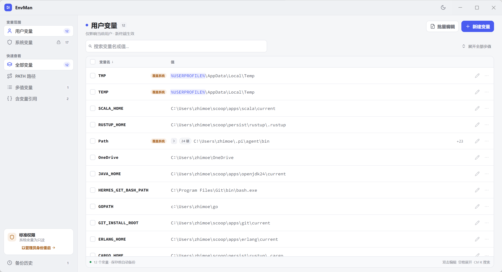

# EnvMan

一个紧凑、原生的 Windows 环境变量管理工具。界面使用
[MyGo](https://github.com/egoist/mygo) native UI 绘制，不依赖 WebView、
HTML、CSS 或 JavaScript。



## 特性

- **双范围浏览**：同时查看用户变量与系统变量，并标记同名覆盖关系。
- **快速定位**：搜索、排序、键盘导航、批量选择、复制与 `.env` 导出。
- **多值变量**：PATH 等 `;` 分隔变量可逐条展开，支持列表编辑、排序与整段编辑。
- **实时差异**：整段编辑时实时显示新增、移除、重复及顺序变化，附带行号。
- **直接写注册表**：读写 Windows 注册表，不使用会截断长值的 `setx`。
- **按需提权**：查看与导出系统变量无需权限；只有实际写入时才通过 UAC 提权。
- **自动备份**：每次写入前自动备份，保留最近 20 份，支持恢复与撤销。
- **并发安全**：保存时保留其他程序在 EnvMan 打开期间新增或修改的无关变量。
- **主题与高 DPI**：浅色、深色、跟随系统三种主题，原生高 DPI 渲染。

## 开发

需要 Go 1.27.3 或更高版本。MyGo CLI 已通过 `go.mod` 的 `tool` 指令固定为
v0.8.3；Git 仅跟踪 `go.mod` / `go.sum`，`vendor/` 在本地生成，不提交到 GitHub。

```sh
# 首次克隆或依赖更新后，生成本地离线依赖
go mod vendor

# 在当前平台运行；非 Windows 平台使用内置演示数据
go run ./cmd/envman

# 运行交互测试和静态检查
go test ./...
go vet ./...
go tool mygo vet .

# 构建免安装的 Windows x64 可执行文件（不生成安装器）
./scripts/build-windows-portable.sh
```

免安装构建产物位于 `build/windows-amd64/`。发布时保留该目录中的
`EnvMan.exe` 和资源文件。

如需同时生成安装器，可直接运行：

```sh
go tool mygo build -platform windows/amd64 .
```

Go 1.14 及之后的工具链在存在 `vendor/` 时会自动使用它。也可以显式进行离线校验：

```sh
GOPROXY=off GOSUMDB=off go test -mod=vendor ./...
```

### Windows 原生集成测试

普通测试不会修改真实环境变量。需要在 Windows 上验证注册表类型、差异写入、
非字符串值保护和环境变化广播时，可显式运行临时变量集成测试；测试结束会自动清理：

```powershell
$env:ENVMAN_WINDOWS_INTEGRATION = "1"
go test -count=1 -run '^TestWindowsUserRegistryIntegration$' ./internal/environment
```

系统变量测试必须从“以管理员身份运行”的 PowerShell 执行：

```powershell
$env:ENVMAN_WINDOWS_SYSTEM_INTEGRATION = "1"
go test -count=1 -run '^TestWindowsSystemRegistryIntegration$' ./internal/environment
```

安装器最终验收还应确认：标准权限启动不弹 UAC；只有保存系统变量时弹 UAC；
提权重启后修改生效且待应用文件被清理；新开的终端能读到修改后的值。

升级依赖后必须同步 vendor 内容：

```sh
go get github.com/egoist/mygo@<version>
go get -tool github.com/egoist/mygo/cmd/mygo@<version>
go mod tidy
go mod vendor
```

列表序号、缩进与引用高亮的复检与修复见
[列表对齐复检记录](doc/list-alignment/ui-list-alignment.md)。

### 打包包含 vendor 的源码

```sh
./scripts/package-source.sh
```

输出 `build/source/EnvMan-source-<commit>.tar.gz`，包含当前 **HEAD 已提交源码**
和按该提交 `go.mod` / `go.sum` 生成的完整 `vendor/`。脚本在临时目录中组装，
不会打包 `.git`、构建产物或未提交文件，也不会修改工作区的 vendor。
首次生成可能需要联网；依赖已缓存后可离线生成。
GitHub 自动生成的 Source code 下载包不包含 vendor；需要离线源码时使用本脚本产物。

## 界面尺寸约定

界面样式按职责集中管理：`internal/app/metrics.go` 管理字号、间距和控件高度，
`geometry.go` 管理圆角，`palette.go` 管理深浅色及高对比度配色，
`theme.go` 组装框架主题，`theme_settings.go` 管理主题偏好与持久化。
新组件应复用语义 token，不要散落字号和颜色字面量。

**圆角**：沿用 Windows Fluent 的两档语义——控件 4、浮层 8，胶囊为全圆。
图标方块按尺寸取 4（<32）或 8（≥32）。

**字号**：共 5 档，随系统"文本缩放"等比放大。

| token | 值 | 用途 |
| --- | --- | --- |
| `fontCaption` | 10 | 分区标签、页脚、行内徽章 |
| `fontSmall` | 11 | 提示、callout、次要说明 |
| `fontBody` | 12 | 默认：行值、按钮、导航项 |
| `fontSubtitle` | 14 | 抽屉、弹窗、空状态标题 |
| `fontTitle` | 18 | 页面标题 |

**间距**：4 栅格加一个 2 半步，`space2 / 4 / 6 / 8 / 12 / 16 / 24 / 32`。
所有 `Gap` 与容器 `Padding` 都取自这一档；组件内部的光学微调（如 1px、1.5px）
保留字面量并就近注释。

**高度**：不拍数字，由行框推导。Segoe UI 的行框约为字号的 1.33 倍，正文 12 →
行框 16，再加垂直内边距：

| token | 值 | 公式 |
| --- | --- | --- |
| `controlXs` | 24 | 行框 + 2×4（行内按钮、图标按钮） |
| `controlSm` | 28 | 行框 + 2×6（轻按钮、行内输入） |
| `controlMd` | 32 | 行框 + 2×8（主次按钮、输入框） |
| `rowH` / `barH` | 32 | 行框 + 2×8（表格行、表头表尾、横幅） |
| `titleBarH` / `paneHeaderH` | 40 | 控件 + 2×8 |
| `pageHeaderH` | 48 | 控件 + 2×8 |
| `sheetFooterH` | 56 | 控件 + 3×8 |

原则：**能由内边距算出来的高度就不写 `Height`**，只有必须固定或等宽的控件
（图标按钮、`List` 行高）才指定高度，这样文本缩放时布局不会错位。

## Windows 数据与权限

- 用户变量：`HKCU\Environment`
- 系统变量：`HKLM\SYSTEM\CurrentControlSet\Control\Session Manager\Environment`
- 备份和待应用更改：`%AppData%\EnvMan`
- 修改后广播 `WM_SETTINGCHANGE`；已经打开的终端不会自动刷新，请新开终端。

EnvMan 默认以标准权限启动。系统变量可以查看、复制和导出；只有实际写入时才请求
UAC。注册表中的非字符串值不会被 EnvMan 删除。

## 项目结构

- `cmd/envman/`：程序入口；`mygo.json` 的 `main` 字段指向此包。
- `internal/app/`：MyGo 原生界面（`metrics.go` 尺寸、`theme.go` 配色与圆角）、
  应用状态和提交/撤销等流程编排。
- `internal/application/`：环境写入用例、环境与备份端口，以及快照/待应用命令契约；不依赖 UI 或基础设施。
- `internal/domain/`：环境变量领域类型、写入不变量校验、差异计算和并发变更合并。
- `internal/environment/`：Windows 注册表后端与非 Windows 内存后端。
- `internal/storage/`：快照、待提权变更和设置的 JSON 持久化。
- 各包内的 `*_test.go`：领域、平台、存储与 native UI 交互测试。
- `vendor/`：本地生成的应用与 MyGo 构建工具依赖源码，Git 忽略。

### 分层与写入边界

依赖方向为 UI → application → domain，storage/environment 作为基础设施实现应用端口。
应用服务统一执行校验、备份、合并和写入；UI 只编排用户交互、展示结果和撤销入口。
当前仍由 app.Run 组装依赖，设置和备份列表查询保留在界面适配层，后续可按实际需要提取查询端口。

提权启动先将 pending.json 重命名为 pending-*.interrupted.json，再执行写入，
成功后删除恢复文件。失败或中断时保留该文件，但不会在下次启动自动重放；
可通过已有备份恢复界面恢复环境，恢复文件供人工排查。该机制不提供多进程事务保证。
并发合并保留无关变量变更，同一变量冲突仍采用本次提交覆盖策略。

文本缩放与 DPI 缩放分开处理：metrics 只应用系统 TextScale，DPI 交给 UI 框架，
避免重复缩放。测试覆盖 100%、125%、150%、200%、225% 文本缩放下的主题与基础渲染，
以及关键文本色对的 4.5:1 对比度；并不代表所有布局或 Windows 多显示器 DPI 已实机验收。
高对比度使用一致的黑白回退调色板，当前框架未提供用户自定义的 Windows 对比主题颜色。
