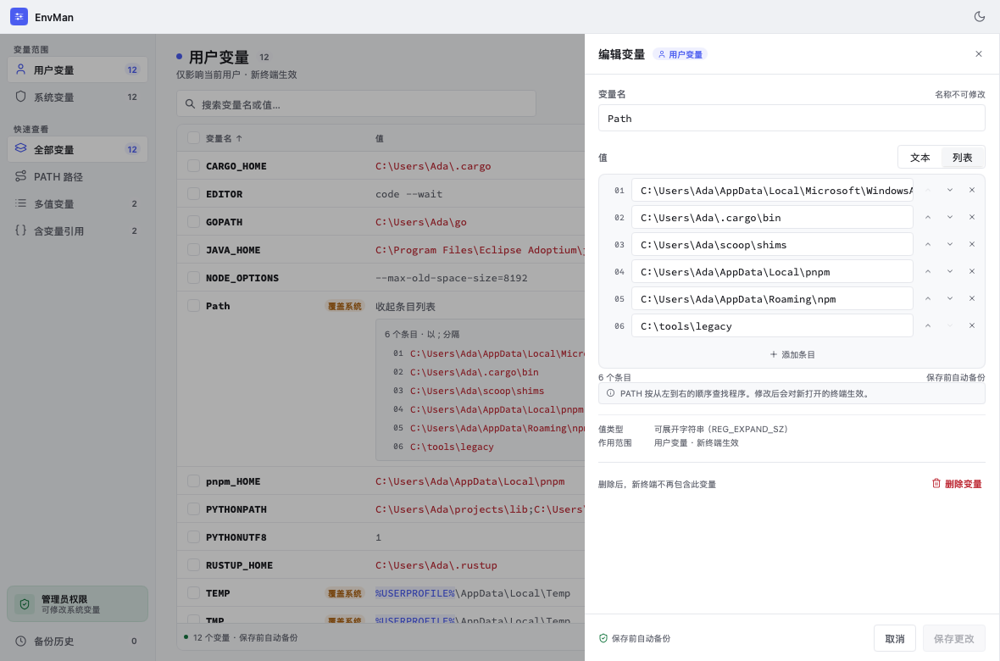
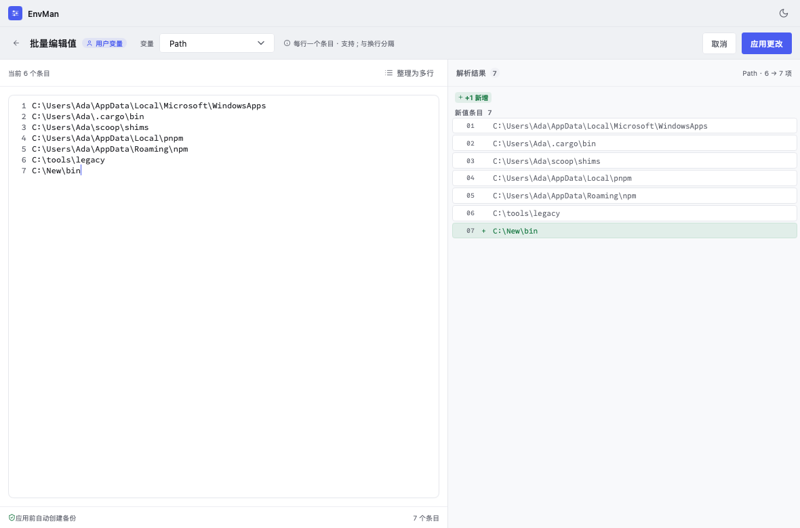

# 列表对齐复检（2026-11-11）

## 问题与修复

| 位置 | 问题/根因 | 修复 |
| --- | --- | --- |
| 主列表多值预览 | 左侧 17 DIP 箭头加 6 DIP 间距，只让多值向右缩进 | 将箭头移至预览文字末尾、数量徽章前；普通值、引用值和多值预览从同一值列起点开始 |
| 主列表变量名表头 | 排序按钮额外 2 DIP 左内边距，与名称正文不齐 | 移除额外内边距 |
| 展开条目列表 | 序号宽 24、正文间距仅 2 DIP | 复用序号栏计算，序号与值间隔 8 DIP；长值换行保持在正文列内 |
| 编辑抽屉条目列表 | 序号宽 15、间距 2 DIP，放大字号/三位数容易拥挤 | 复用序号栏计算，统一 8 DIP 行间距及 4 DIP 水平内边距 |
| 整段编辑器行号 | 固定宽 22，不随字号/行数增长 | 用正文号字测量行号栏，最少预留三位，行号与编辑区间隔 8 DIP；同步更新视口宽度计算 |
| 批量解析/移除预览 | 序号宽 16、间距 2；仅变更行有标记列，普通值左移 | 共用序号栏和 8 DIP 间距；所有行均预留同宽状态栏，新值和移除区使用共同总条数决定列宽 |
| `%JAVA_HOME%` 等引用及搜索命中 | `Span.Radius=2` 让框架绘制背景时向左右外扩，背景起点越过值列 | 使用平直行内背景，保留强调色与搜索命中颜色，不增加水平 padding，也不移动文字 |
| 侧栏、备份历史 | 图标占位固定、正文列统一；没有序号窄栏或条件性左侧插入 | 已复检，沿用现有布局 |

## 统一规则

- 序号右对齐、正文左对齐；同一列表的序号栏宽度必须相同。
- 序号栏至少 24 DIP，同时按当前字体实际测量至少三位数字；超过三位时按列表总条数扩展。
- 序号、状态栏、正文之间使用 8 DIP 间隔，不依赖空格字符凑间距。
- 行内强调不得越过正文左边界；展开/缺失/增删状态不能改变相邻同类行的正文起点。
- 主列表展开面板是子列表，自带序号栏。宽窗口面板对齐值列；小于 1050 DIP 时保留原有对齐变量名列的响应式布局，为长路径留空间。
- 输入框保持其自身内边距；对齐的是输入框列，框内文字不与无边框预览强行使用同一坐标。

## 验证

- `CGO_ENABLED=0 go test ./...`：通过，含现有编辑、批量应用、主题/文本缩放交互测试。
- `CGO_ENABLED=0 GOPROXY=off GOSUMDB=off go test -mod=vendor ./...`：通过，离线 vendor 校验完成。
- `CGO_ENABLED=0 go vet ./...`：通过。
- `CGO_ENABLED=0 go tool mygo vet .`：通过。
- `CGO_ENABLED=0 GOOS=windows GOARCH=amd64 go build -o /tmp/envman-layout-windows.exe ./cmd/envman`：通过。
- 使用 MyGo headless Tester 渲染并人工查看主列表、抽屉、批量预览（含新增行）以及 960×900、200% 文本缩放下的深色主列表。序号与正文间距、引用背景边界、增删状态栏及尾部箭头符合规则。临时截图导出测试已删除。
- 200% 文本缩放的窄窗口下，侧栏文字仍会省略，长路径会换行；本次不改变既有侧栏宽度和主表固定列宽。

本机默认启用 CGO 的测试因系统 C 链接器无法识别 macOS SDK 的 `arm64e.x1` 架构而失败，纯 Go 模式下验证通过。本机为 macOS，Windows 原生字体/DPI 与窗口行为仍需 Windows 实机确认。

### 修复后截图

主列表：普通值、引用高亮和多值摘要保持相同左边界，箭头位于尾部。

编辑抽屉：序号栏与输入框留出统一间距。

批量编辑：行号留白，普通项与新增项的正文对齐。

